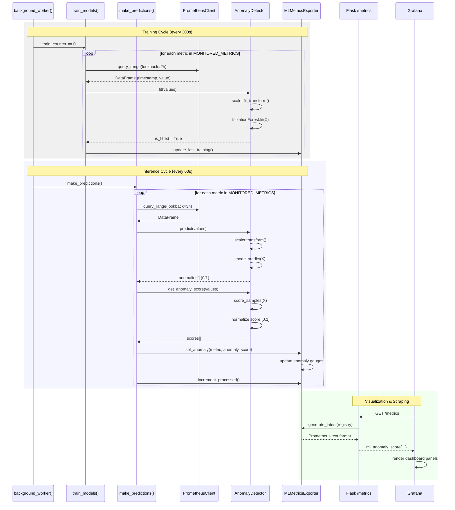

# Sequence Diagram: Isolation Forest Inference & Export Cycle

This diagram details the internal software execution flow for Sprint 6, covering the training, inference, and visualization cycles.

### Key Logic Steps:
- **Normalization**: Data is scaled using `StandardScaler` before both training and inference.
- **Scoring**: Anomaly scores are calculated using `-model.score_samples(X)` and then normalized to a 0-1 range.
- **Persistence**: The results are stored in Prometheus Gauges, which are then exposed via a Flask endpoint for Grafana to consume.
